<div align="center">
  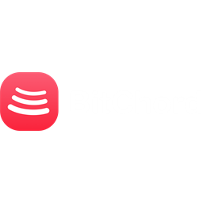
  <h1>WaveForm Desktop</h1>
  <p><strong>Apple Music-inspired Liquid Glass desktop music player built with Electron, React 19, a Rust <code>napi-rs</code> Native Performance Core, Web Audio DSP, and 12 hardware-accelerated lyric visualizers.</strong></p>

  <p>
    <a href="https://github.com/Trapston3/waveform-desktop/releases/tag/v1.3.4"></a>
    
    
    
    
    
  </p>
</div>

---

## Screenshots (`v1.3.4`)

| Now Playing & Apple Music Fluid Mesh | iOS Group Chat + Kinetic Glow (`iosTextingMotion`) |
| :---: | :---: |
| 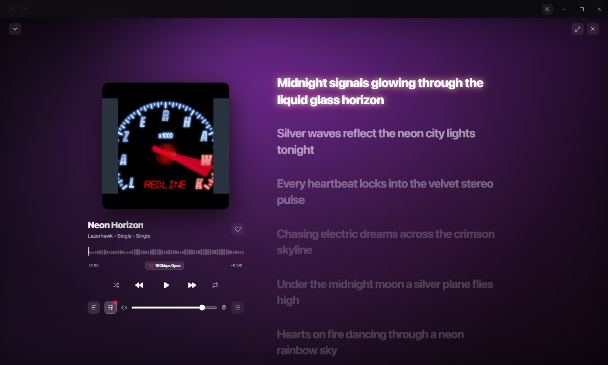 | 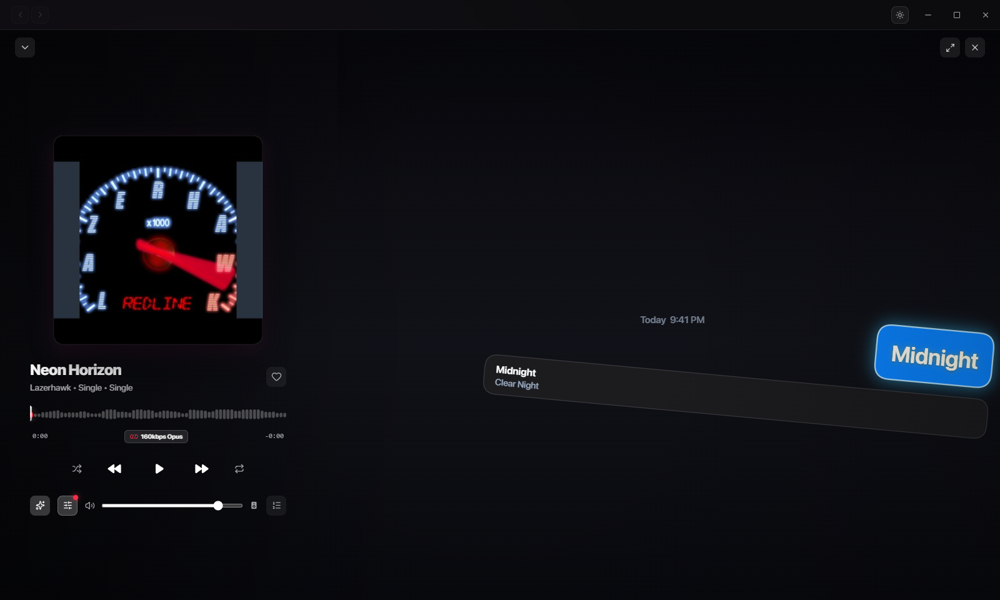 |

| 2.5D Three.js Apple Maps Navigation | Solari Split-Flap Departure Board |
| :---: | :---: |
| 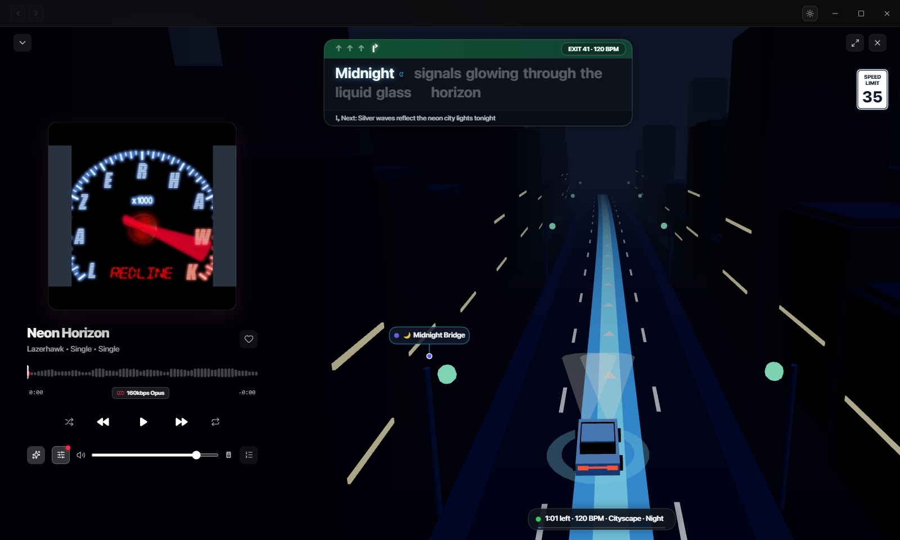 | 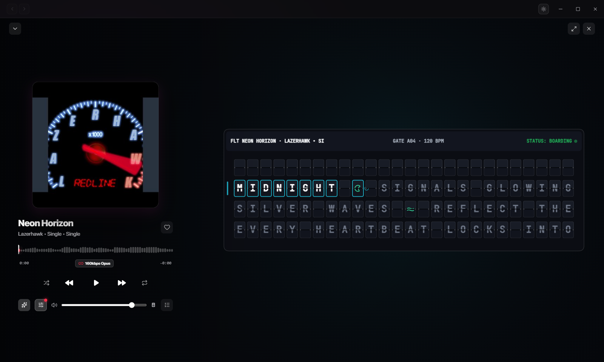 |

| Studio DAW Multi-Track Timeline | Motion Geometry — Constellation |
| :---: | :---: |
| 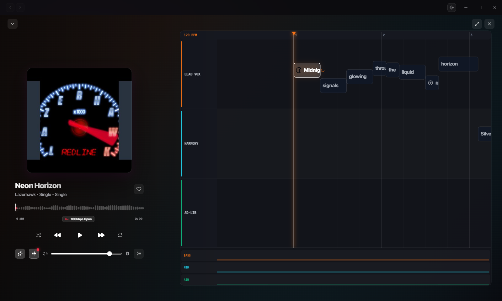 | 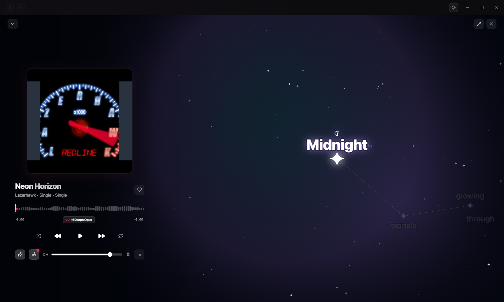 |

| Code Editor Kinetic Visualizer | Arcane Spaceship 3D (Blasting & Scribbles) |
| :---: | :---: |
| 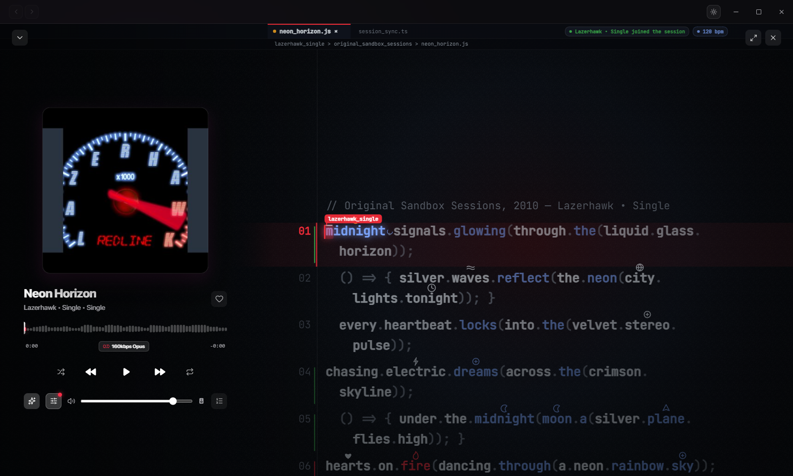 | 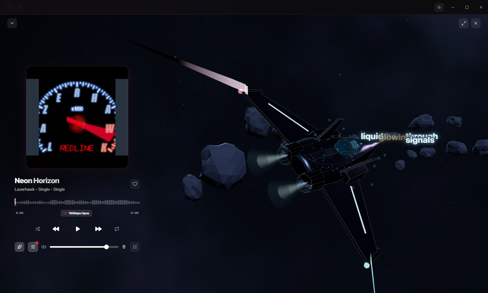 |

| Lyrics Focus Mode (Minimal Controls) | 3D Cover Flow & Library |
| :---: | :---: |
| 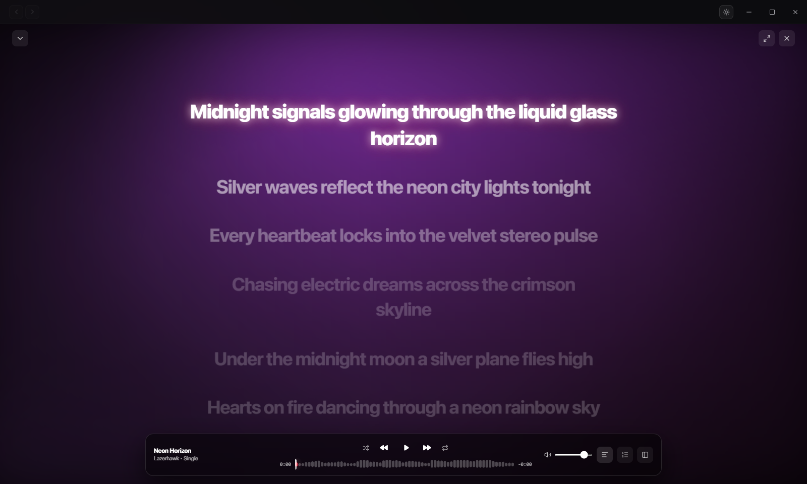 | 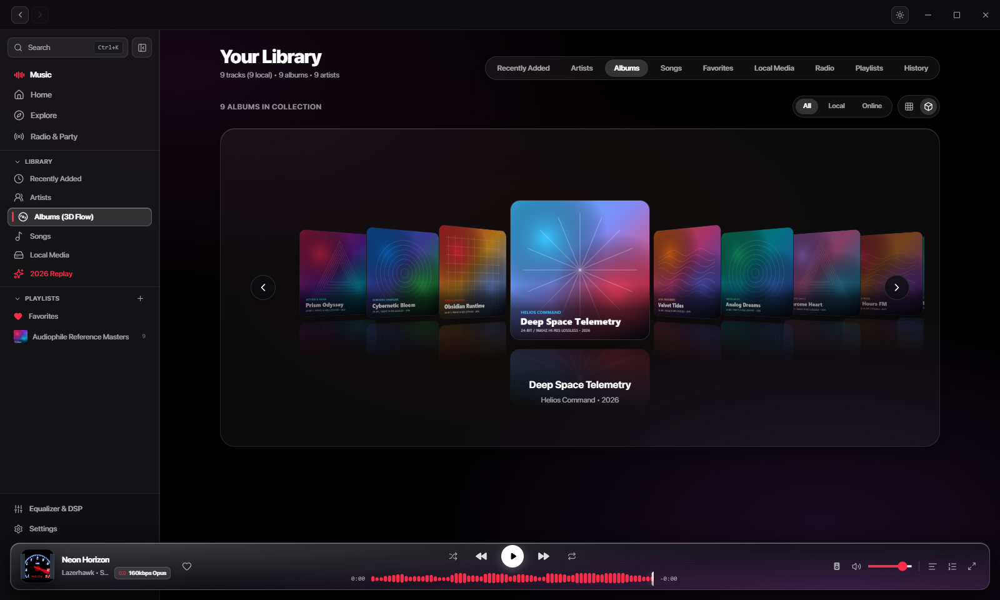 |

---

## Install & Auto-Update (Windows x64)

### One-Line PowerShell CLI Installer (Recommended)

Downloads the latest Windows `.exe` from [GitHub Releases](https://github.com/Trapston3/waveform-desktop/releases/latest), verifies its SHA-256 checksum against `SHA256SUMS.txt`, and installs or updates WaveForm Desktop:

```powershell
irm https://raw.githubusercontent.com/Trapston3/waveform-desktop/main/scripts/install.ps1 | iex
```

**Additional CLI flags** (`scripts/install.ps1`):

```powershell
# Portable mode (no installer wizard, installs to %LOCALAPPDATA%\Programs\WaveForm + Start Menu shortcut)
& ([scriptblock]::Create((irm https://raw.githubusercontent.com/Trapston3/waveform-desktop/main/scripts/install.ps1))) -Portable

# Silent NSIS setup (automatically performs a fast changed-files-only update if already installed)
& ([scriptblock]::Create((irm https://raw.githubusercontent.com/Trapston3/waveform-desktop/main/scripts/install.ps1))) -Silent

# Force a clean reinstall (passes /FRESH to Setup.exe)
& ([scriptblock]::Create((irm https://raw.githubusercontent.com/Trapston3/waveform-desktop/main/scripts/install.ps1))) -Fresh -Force

# Pin a specific release tag
& ([scriptblock]::Create((irm https://raw.githubusercontent.com/Trapston3/waveform-desktop/main/scripts/install.ps1))) -Version v1.3.2 -Portable
```

### Direct `.exe` Download & Fast Delta Updater

Grab [`WaveForm-Setup-1.3.4.exe`](https://github.com/Trapston3/waveform-desktop/releases/download/v1.3.4/WaveForm-Setup-1.3.4.exe) (NSIS installer) or [`WaveForm-Portable-1.3.4.exe`](https://github.com/Trapston3/waveform-desktop/releases/download/v1.3.4/WaveForm-Portable-1.3.4.exe) (standalone executable) from the [v1.3.4 Releases page](https://github.com/Trapston3/waveform-desktop/releases/tag/v1.3.4).

### One-Click In-App Auto-Updater (`electron/appUpdater.ts`, `UpdatePromptModal.tsx`)

- **Cold-Boot Update Reminder**: Automatically checks GitHub Releases ~2.5s after launch (silent on offline/network errors). Choosing **Remind Me Next Launch** dismisses the prompt only for the active session and keeps a subtle **Update Available** pill in the title bar.
- **Direct Delta-File Self-Updater**: Compares `resources/install-manifest.tsv` & `electronVersion` against the remote release manifest while ignoring `WaveForm.exe` version-stamp diffs when the Electron runtime matches. Streams `WaveForm-AppPatch-<version>.zip`, verifies SHA-256 digests on both archive and extracted files, atomically updates `resources/` including `resources/app-version.json` with 12x retry, backup/rollback, UAC elevation prompt when needed, and `--updated-from` confirmation toast on relaunch.

---

## Native Rust Performance Core (`native/waveform-core`)

WaveForm v1.3.4 compiles a native Windows x64 `napi-rs` addon (`waveform-core.win32-x64-msvc.node`, unpacked cleanly outside `app.asar`) with automatic pure-TypeScript fallback when running outside Electron:

- **SQLite AutoEQ Engine (`src/autoeq.rs`, `rusqlite` bundled)**: Indexes all 17,703 rows (8,850 parametric `PaP\x01` profiles) into a normalized accent/punctuation-stripped 36-bit bitmask + trigram index for sub-millisecond fuzzy search (`sony whch-720n` → `Sony WH-CH720N`) and Boundary-07 parametric filter decoding.
- **Multi-Core Parallel Media Scanner (`src/scanner.rs`, `lofty` + `rayon` + `walkdir` + `sha2`)**: Scans local folders incrementally against cached `(path, mtimeMs, size)` diffs across all CPU cores, extracts tags, synced/unsynced lyrics (`USLT`/`SYLT`/`©lyr`/`LYRICS`), and writes content-addressed deduplicated cover art into `userData/artwork-cache/`.
- **Real-Time DSP, FFT & Native ONNX ML Engine (`src/dsp.rs`, `src/onnx_engine.rs`, `realfft` + `ort`)**: Powers live RBJ/SVF 10-band EQ curves, 32-band spectra, and background-thread ONNX / STFT inference (`beat_this_final0_q8.onnx` & `vocals_umxhq_int8.onnx`) for neural PCM beat/downbeat detection (`onnx_analyze_track_beats_pcm`), vocal stem separation (`onnx_separate_vocals_pcm`), chorus hook detection, vocal-silence gap detection, and cross-correlation Auto-Lyric Sync (`estimate_lyric_offset_ms`).

---

## Features

### Dual-Deck Audio Engine, Karaoke & Neural ML Intelligence (`src/audio/`, `src/services/MlAudioService.ts`)
- **Phase-Coherent Live Karaoke (`Mic2` Control)**: 3-band Mid/Side matrix (`Side + <180Hz + >5.5kHz` preserving >90% instrumental stereo energy while removing center vocals) paired with `KaraokeProcessor` and background Open-Unmix neural vocal stem separation (`0%–100%` Vocal Level slider + Isolate Vocals mode).
- **Neural Beat-Locked Auto-Mix & Queue Integration**: `TransitionProcessor.findBestDownbeatTransitionWindow` aligns Auto-Mix transitions onto outgoing/incoming neural downbeats while avoiding vocal clashes, driven live by dual-deck 18s preloading, Queue sidecar **Auto-Mix** pill + `Mixing into ...` indicator, and Settings **Auto-Mix Style / Overlap** controls.
- **Auto-Sync Lyrics & Synced-First Multi-Provider Waterfall**: Strict synced-first lookup across Embedded tags -> LRCLIB exact/ranked search -> NetEase Cloud Music -> Kugou -> InnerTube before plain text fallback; automatically runs neural Auto-Sync on synced tracks (`±15s` with reset badge), and gracefully shows Classic full-contrast `Plain Lyrics · Unsynced` view without fake timestamps on unsynced tracks.
- **CORS-Resilient Dual-Deck Playback (`AudioEngine.ts`)**: Dual deck architecture (`deckA` / `deckB`) with constant-power crossfading, `waveform-local://` HTTP Range (`206 Partial Content`) local streaming, and automatic lazy unbound `<audio>` direct fallback if an external media CDN fails CORS or `MediaElementAudioSourceNode` routing.
- **10-Band Equalizer & Interactive AutoEQ Graph (`DspChain.ts`, `AutoEqLoader.ts`, `InteractiveEqGraph.tsx`)**: Live Web Audio `BiquadFilterNode` chain paired with the native Rust SQLite AutoEQ database (`src/assets/data/auto_eq.db`), spatial stereo width processing, ReplayGain normalization, and a lookahead peak limiter.
- **68-Bar Waveform & Live PCM Visualizer (`WaveformExtractor.ts`, `LiveVisualizer.ts`, `WaveformCanvasSeekbar.tsx`)**: Hardware-accelerated High-DPI canvas seekbar with optimistic seek latching.

### LyricVisualizer Subsystem (`src/lyricVisualizer/`, `electron/lyricVisualizerPlatform.ts`)
- **Creator Studio (`v1.3.4`) — 12 Consolidated Visualizers, 15s Clip Export & Word Micro-FX**: Exports 15s (`16:9` / `9:16` / `1:1`) WebM clips with synced audio via `MediaRecorder`, imports/exports JSON style presets, renders semantic `wordIconDictionary` icons & micro-animations across every theme, and ensures edge-safe Beat Camera Thump overscan.
- **Flagship iOS Native Design (`IosTextingMotion`)**: Four flagship modes — `Messages` (with Kinetic Pop-up Mode & Zoom), `Liquid Glass`, `Group Chat` (colorful avatar PFPs + active luminescence), and Three.js `2.5D Navigation Map` with genre-aware biomes (`Cityscape` / `Highway` / `Countryside`) & time-of-day lighting.
- **Arcane Spaceship 3D, Solari Split-Flap & Studio DAW**: Reworked 3D starfighter with same-altitude word spawns, multi-piece asteroid shattering revealing hidden lyrics, and Arcane neon scribble overlays, alongside OKLCH album-art-matched `Solari Split-Flap` and `Studio DAW Timeline`.
- **Multi-Surface Windows Guards**: Embeds in `NowPlayingScreen` (with unified **Studio Tools** popover & decluttered context menu), multi-monitor click-through Desktop Overlays (`#/overlay`), and Fullscreen Ambient Mode (`#/ambient`) with `KeepAwake`, fullscreen game suppression, and lock-screen `0%` GPU suspend. See [DECISIONS.md](DECISIONS.md).

### Power Tools, Offline Pinning & Practice Suite (`v1.3.2`)
- **Native Last.fm & ListenBrainz Scrobbling (`electron/scrobbler.ts`)**: Signed MD5 Last.fm (`track.updateNowPlaying` / `track.scrobble`) and ListenBrainz token validation + submission at `50%` or `240s` played, backed by a persistent `scrobble-queue.json` offline retry queue.
- **Drag-and-Drop Custom `.lrc` / `.txt` & LRC Editor (`electron/customLyricsStore.ts`, `LrcEditorModal.tsx`)**: Drop `.lrc`/`.txt` files directly onto Now Playing, edit raw `.lrc` lines, tap-to-sync timestamps live, and persist per-track timing offsets (`-500ms/+500ms`, `-100ms/+100ms`).
- **Customizable Global Hotkeys (`electron/globalHotkeys.ts`)**: System-wide customizable keybindings for Play/Pause, Next/Previous, Karaoke, Cycle Visualizer Theme, Jump Back 5s, and Fullscreen Ambient with conflict detection and Reset Defaults.
- **Offline Pinning & LRU Disk Cache (`electron/offlineCache.ts`)**: Pin tracks, albums, or playlists for instant zero-network `waveform-local://` playback under a configurable `1–50 GB` LRU cache (`5 GB` default) that never evicts pinned tracks.
- **Bar-Snapped A–B Loop & Pitch-Preserving Practice Speed (`src/utils/practiceLoop.ts`)**: Snap `4 / 8 / 16` bar loops directly to persistent `beat_this` downbeats with glowing draggable `A`/`B` brackets on the 68-bar waveform seekbar and `0.5x–1.5x` pitch-preserved speed in sync with lyrics & visualizers.

### Zero-API-Key URL Import, Smart Radio Queue & Permanent Replay
- **Spotify & Apple Music URL Playlist Importer (`electron/playlistImporter.ts`, `ImportPlaylistModal.tsx`)**: Paste any public Spotify or Apple Music playlist URL to preview metadata and concurrently match tracks into permanent local WaveForm playlists with zero API keys.
- **Genre-Matched Up Next Radio & Interactive Queue (`queueStore.ts`, `RightSidecar.tsx`)**: Playing from Search starts that single track paired with YouTube Music Up Next Radio (`RDAMVM<videoId>`), filters out podcasts/episodes/`>15 min` shows/title-spam covers, isolates `USER_QUEUE` vs `AUTOPLAY`, and adds drag-and-drop reordering, move up/down, hover remove (`×`), `Start Song Radio`, `Shuffle Up Next`, and `Save as Playlist`.
- **Permanent 2026 Replay Disk History (`electron/replayStore.ts`, `StorageService.ts`)**: Continuous 1-second playback accumulation flushed atomically to `userData/replay-history.json` (`.bak` recovery + automatic `localStorage` migration) so real listening minutes persist permanently across updates.
- **YouTube SABR & Account Connections (`youtubeSabrStream.ts`, `accountAuth.ts`)**: Server-driven ABR (`SabrStream`) with `SAPISIDHASH` auth isolation, progressive HTTP `206` streaming, `yt-dlp` fallback, Spotify Playlists shelf, Discord Rich Presence (`discordRpc.ts`), and Party LAN/WebRTC sync (`PartySyncClient.ts`).
- **Liquid Glass Desktop UX (`src/ui/`)**: Unified top-left sidebar search (`Ctrl+K`), collapsible icon rail (`64px`), dynamic album-cover OKLCH accent extraction, tray minimize/close controls, and `2026 Replay`.

---

## Project Architecture

```text
waveform-desktop/
├── build/                      # App icons (icon.ico, icon.png), NSIS installer.nsh & diff-sync.ps1
├── DECISIONS.md                # LyricVisualizer Electron-native & Windows architecture decisions
├── electron/
│   ├── main.ts                 # Electron main process, protocol handlers, window & tray, IPC
│   ├── preload.cts             # Context-isolated electronAPI bridge
│   ├── nativeCore.ts           # Rust napi-rs addon loader with graceful pure-JS fallback
│   ├── appUpdater.ts           # Cold-boot update checker, manifest delta planner, SHA-256 verifier & PS applier
│   ├── autoEqDb.ts             # Native/JS AutoEQ SQLite search & PaP parametric decoder
│   ├── localMetadata.ts        # Native/JS parallel folder scanner, artwork cache & tag extractor
│   ├── youtubeSabrStream.ts    # SABR streaming client, visitorData cache, progressive HTTP 206 server
│   ├── lyricVisualizerPlatform.ts # Multi-monitor overlays, Ambient window, game guard, cache store
│   ├── discordRpc.ts           # Rich Presence IPC client with backoff & LRU art cache
│   ├── accountAuth.ts          # YouTube Music SAPISIDHASH & Spotify playlist API helpers
│   └── appIcon.ts              # Cross-platform BrowserWindow & tray icon resolution
├── native/
│   └── waveform-core/          # Rust napi-rs crate (autoeq, scanner, dsp, onnx_engine)
├── scripts/
│   ├── dev.mjs                 # Vite + Electron development launcher
│   ├── start.mjs               # Production launcher
│   ├── after-pack-manifest.mjs # Deterministic SHA-256 install-manifest.tsv & AppPatch zip generator
│   ├── generate-checksums.mjs  # Release SHA256SUMS.txt, latest.yml & Scoop sync
│   └── capture-readme-screenshots.mjs # Automated Electron showcase capture harness
├── src/
│   ├── audio/                  # Dual-deck AudioEngine, DSP chain, AutoEQ, visualizer & FFT/RMS metrics
│   ├── lyricVisualizer/        # Core sync/OKLCH/pipeline, 14 WebGL2/Canvas2D styles, bridge & UIs
│   ├── models/                 # Normalized Song, Playlist, Navigation, Settings models
│   ├── services/               # InnerTube, StreamResolver, LyricsService, PartySyncClient, Spotify
│   ├── state/                  # Zustand stores (player, queue, library, lyrics, nav, settings, updater)
│   └── ui/                     # Liquid Glass layout, common modals (UpdatePromptModal), views & player
└── tests/                      # 4-tier E2E runner, acceptance suite & targeted unit tests
```

---

## Getting Started

### Prerequisites
- **Node.js 20+** (tested on Node v25.6.1 / Windows x64)
- **Rust stable toolchain (`x86_64-pc-windows-msvc`)** + MSVC Build Tools (optional for JS-fallback dev; required for `build:rust` & `dist:win`)

### Install & Run in Development

```bash
npm install
npm run build:rust
npm run dev
```

### Production Build & Windows Packaging

```bash
npm run build
npm start

# Build Windows x64 NSIS Setup & Portable installers + SHA256SUMS.txt
npm run dist:win
```

### Verification & Tests

```bash
# Rust native core unit tests (AutoEQ, parallel scanner, DSP/FFT, ONNX)
npm run test:rust

# TypeScript checks (renderer, Electron main, preload)
npm run typecheck

# 4-tier test suite (311 tests)
npm test

# Targeted unit tests (Rust core, updater, visualizers, audio, metadata, SABR, RPC, installer)
node --test tests/unit/*.test.mjs
```

---

## Keyboard Shortcuts

| Shortcut | Action |
| :--- | :--- |
| `Space` | Play / Pause |
| `Ctrl+K` / `Ctrl+F` | Focus top-left search input (expands sidebar if collapsed) |
| `ArrowLeft` / `ArrowRight` | Seek `-5s` / `+5s` (`Shift` for `-15s` / `+15s`) |
| `J` | Seek `-5s` |
| `ArrowUp` / `ArrowDown` | Volume `+5%` / `-5%` |
| `M` | Toggle Mute |
| `L` | Toggle Lyrics Sidecar |
| `Q` | Toggle Up Next Queue Sidecar |
| `F` | Toggle Now Playing view |
| `Esc` | Exit fullscreen / close active overlay, modal, or sidecar |
